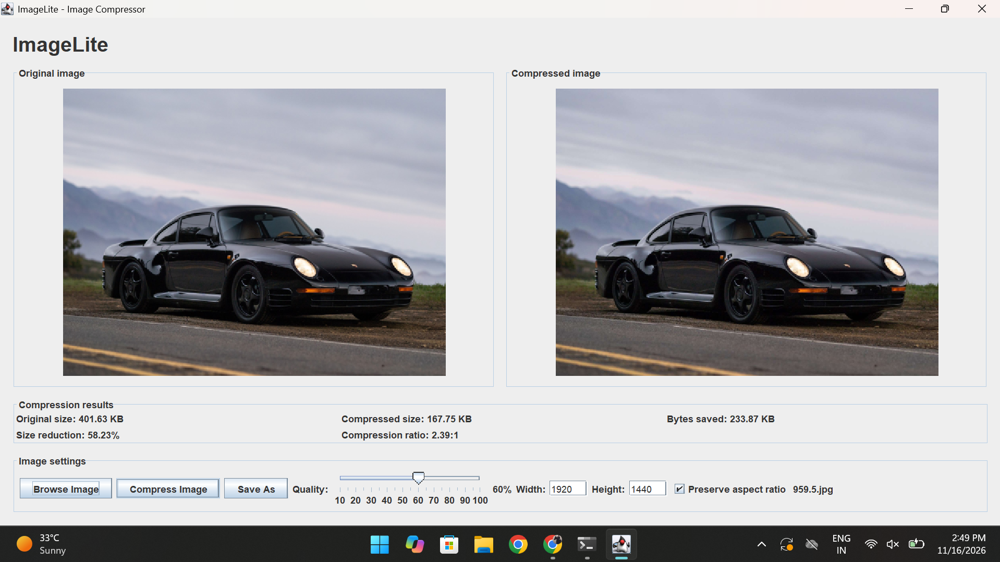

# ImageLite — Image Compressor

## Project Description

ImageLite is an application designed to reduce image file sizes while maintaining acceptable visual quality. It provides users with a graphical interface to load images, adjust JPEG compression quality, resize images while preserving their aspect ratio, preview the processed output, and save compressed images.

## Final Application

### Main Application Interface


### Original Image Preview


### Compression Output



## Features

- **Image Loading:** Supports JPG, JPEG, and PNG image formats.
- **Image Preview:** Displays the original image before processing.
- **Adjustable Compression:** Allows users to control JPEG compression quality.
- **Image Resizing:** Enables users to specify custom image dimensions.
- **Aspect Ratio Preservation:** Maintains image proportions during resizing.
- **Compression Statistics:** Displays original and compressed file sizes, percentage reduction, and compression ratio.
- **Output Preview:** Displays the compressed image for comparison.
- **Save Compressed Images:** Allows users to export the processed image to a selected location.

## How It Works

ImageLite uses Java's built-in image processing capabilities to perform image resizing and JPEG compression.

The processing workflow consists of the following stages:

1. **Image Loading and Validation:** The selected image is loaded using Java ImageIO. Its format, dimensions, and file information are checked.
2. **Image Resizing (Optional):** Users can specify new dimensions. Bicubic interpolation is used to resize the image, with aspect ratio preservation available.
3. **Image Conversion:** The image is converted to an RGB representation suitable for JPEG encoding. Transparent areas are composited against a white background.
4. **JPEG Compression:** Java ImageIO's JPEG ImageWriter is used with explicit compression settings. The selected quality value controls the compression level.
5. **Result Analysis:** The application calculates the resulting file size, percentage size reduction, and compression ratio.
6. **Output:** The compressed image is displayed in the application and can be saved to the user's chosen location.

JPEG compression is lossy, meaning that reducing file size can involve some loss of visual information. The quality control allows users to balance file size and image appearance.

## Technologies Used

| Component | Technology |
|---|---|
| Programming Language | Java 21 |
| GUI Framework | Java Swing |
| Image Processing | Java AWT and Java ImageIO |
| Build Tool | Apache Maven |
| Testing Framework | JUnit 5 |
| Version Control | Git and GitHub |

## Project Structure

```text
CSC360-Group8-EndSem/
├── docs/
├── screenshots/
├── src/
│   ├── main/
│   │   ├── java/com/csc360/
│   │   │   ├── compression/
│   │   │   ├── gui/
│   │   │   ├── imageprocessing/
│   │   │   └── utils/
│   │   └── resources/
│   └── test/
│       └── java/com/csc360/
├── .gitignore
├── pom.xml
└── README.md
```

### Main Components

- **compression:** Handles JPEG compression, processing options, compression metrics, processing results, and output writing.
- **gui:** Contains the Swing-based application interface.
- **imageprocessing:** Handles image loading, resizing, and conversion.
- **utils:** Provides image validation and metadata utilities.
- **test:** Contains unit, integration, edge-case, and end-to-end tests.

## How to Run

### Requirements

- Java Development Kit (JDK) 21 or later
- Apache Maven 3.9 or later
- Git

### 1. Clone the Repository

```bash
git clone https://github.com/Denim-Ahir/CSC360-Group8-EndSem.git
```

### 2. Navigate to the Project Directory

```bash
cd CSC360-Group8-EndSem
```

### 3. Build the Application

```bash
mvn clean package
```

### 4. Run the Application

```bash
java -cp target/classes com.csc360.Main
```

## Testing

The project uses JUnit 5 for automated testing.

The test suite covers:

- Image processing unit tests.
- Image workflow edge cases.
- End-to-end image processing.
- JPEG compression integration.

Run the tests using:

```bash
mvn clean test
```

**Current test results:** 15 tests passed, with 0 failures and 0 errors.

## Academic Information

- **Course:** CSC360 — Computer Graphics and Digital Image Processing
- **Project:** ImageLite — Image Compressor
- **Institution:** Ahmedabad University
- **Repository:** [CSC360-Group8-EndSem](https://github.com/Denim-Ahir/CSC360-Group8-EndSem)

---

*Developed as a group project for CSC360.*